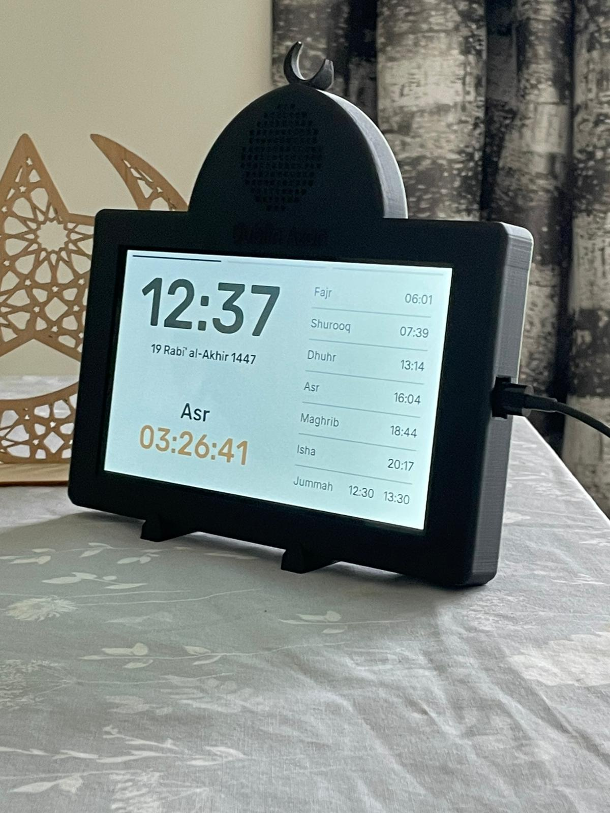

# Dublin Azan Clock

A wall-mounted Smart Azan Clock built around an ESP32-S3 and a 7-inch touchscreen display. This is a real product that was designed, programmed, sold, and maintained for paying customers.

## Introduction

Dublin Azan Clock displays daily prayer times, plays Azan and Quran audio, and synchronises time via the internet. The device wall-mounts in a home or prayer space and provides a clean graphical interface for checking the next prayer, viewing the Hijri date, and adjusting settings.

Because the clock synchronises via SNTP, prayer times update automatically. Users can select from multiple Azan recordings, adjust volume and display brightness, and choose from several reciters for Quran playback.

The photograph above shows the actual clock displaying prayer times on its screen.

## Features

- **Graphical interface** developed in C++ using ESP-IDF and LovyanGFX on a 800×480 touchscreen display
- **Daily prayer times** retrieved via HTTP, parsed and stored in SPIFFS, with automatic SNTP time synchronisation
- **Adhan (Azan) playback** via I²S-driven DAC with minimp3 decoder; six adhan selections (Default, Makkah, Madinah, Al-Aqsa, Egyptian, Muhammad Jazi)
- **Quran recitation playback** with eleven built-in reciters, including support for missing surah files
- **Time synchronisation** via SNTP (Google Cloud, Pool NTP, Cloudflare) with automatic retry and fallback
- **Wi-Fi connectivity** with stored credentials in NVS; reconnection with exponential back-off
- **Remote firmware updates** via OTA (ESP HTTPS OTA) from a signed binary hosted on GitLab
- **Persistent settings** (brightness, volume, Azan selection, reciter, display format) stored in NVS
- **Backlight dimming** after periods of inactivity; high-frequency PWM to eliminate audible coil whine
- **Touchscreen interaction** for switching between full/minimal view, settings, and control panel

## Technical Implementation

The firmware is built on ESP-IDF with FreeRTOS task scheduling. Key engineering aspects include:

- **LovyanGFX graphics pipeline** — A custom `LGFX` class initialises the RGB-panel display and GT911 touch controller at startup. Sprites (`LGFX_Sprite`) are used for the time, date, prayer counters, and UI updates, each allocated in PSRAM to avoid heap fragmentation. The main display loop redraws only changing elements each second, minimising screen tear and power draw.

- **Prayer-time retrieval and SNTP sync** — Prayer times are fetched via HTTP from a remote server, validated, and written to SPIFFS. The `run_sntp` function configures three NTP servers (time.google.com, pool.ntp.org, time.cloudflare.com) with automatic server renewal after a new IP address is detected. A callback (`sntp_sync_prayer_check`) checks whether the day's prayer schedule has changed after a time sync, triggering a full prayer re-fetch if needed.

- **I²S MP3 playback** — Audio is decoded from MP3 using the minimp3 library and played back through the I2S peripheral at 44.1 kHz, 16-bit mono. The decoder handles sample-rate changes on-the-fly, reconfiguring the I2S clock without stopping playback. Stereo audio is downmixed to mono by selecting the left channel. A volume control applies per-sample gain with clipping protection.

- **FreeRTOS task management** — The main `app` task creates and deletes subsidiary tasks (init clock, audio playback, UI updates) as needed. Audio playback runs in a dedicated task (`s_audio_task_handle`) that can be signalled via task notification to pause or restart during OTA updates or configuration changes.

- **Non-volatile storage** — NVS stores Wi-Fi credentials and user settings (brightness, volume, selected Azan/reciter). SPIFFS stores daily prayer times and Jamāʿah/Iqamah data, persisting across reboots. Filesystem initialisation includes graceful handling of mount failures and formatting-if-requested.

- **OTA firmware updates** — The `update_to_latest` function downloads a new application image via HTTPS using `esp_https_ota`, verifies the app description and image header, and reboots into the updated partition. A certificate bundle (gitlab.pem) is embedded for TLS verification of the update server. The update process is designed to be non-critical by default: if the download is incomplete or verification fails, the device continues running the current firmware.

- **Touchscreen and UI interaction** — The touch controller (GT911) is polled from the main loop. Touch coordinates are mapped to UI regions (time display, prayer list, settings button) and trigger tab switches or settings dialogs. A `block_touch` flag prevents double-taps during UI transitions.

- **Memory and resource constraints** — The ESP32-S3 has ample PSRAM for sprite buffers and font glyphs, but heap fragmentation is mitigated by pre-allocating sprite dimensions at initialisation and reusing buffers. The MP3 decoder buffer is 16 KB, and DMA frames are tuned for the 44.1 kHz audio pipeline.

## From Prototype to Product

The project began as an embedded systems experiment to display prayer times on a connected screen. After achieving a working prototype, the focus shifted to reliability and polish for actual use: prayer-time fetching was made resilient to network hiccups, the MP3 playback pipeline was stabilised, and the touch interface was iterated through several layout passes.

A custom 3D-printed enclosure was designed to house the ESP32-S3, display, and power circuitry in a wall-mountable form factor. The enclosure design was revised multiple times based on fit-testing and accessibility considerations (cable routing, button access, screen visibility).

Devices were deployed to real customers who used the clock daily. Ongoing maintenance included remote bug fixes delivered via OTA, response to feature requests (additional Azan selections, new reciters, display format preferences), and occasional SPIFFS resets dispatched to units experiencing filesystem corruption. The OTA update mechanism meant that most fixes could be pushed without requiring physical interaction with the deployed hardware.

## Repository Contents

This public repository contains:

- **OTA firmware files** (`bigt.bin`, `testing.bin`) used to update deployed devices.
- **Azan audio files** and other product assets (MP3 files for adhan selections, city/config lists).
- Configuration files (`sdkconfig`, `partitions.csv`) that reflect the build environment used during development.

The actual firmware source code is **not** included in this repository. The source remains in the private `../firmware` directory. The purpose of this public repo is to showcase and document the completed product while retaining the firmware and audio distribution files. OTA binaries and audio files are distributed here so that deployed devices can receive updates and content; the complete embedded application source is not open-source and is retained separately.

---

*This README is intended as an engineering portfolio showcase. It describes real implementation decisions and the product's real-world deployment history without exaggeration or fictional benchmarks.*